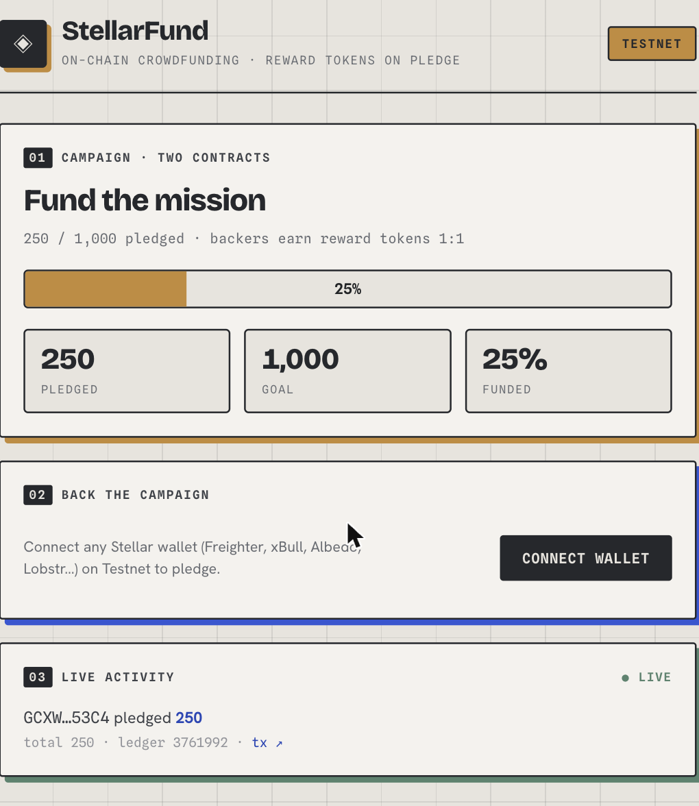
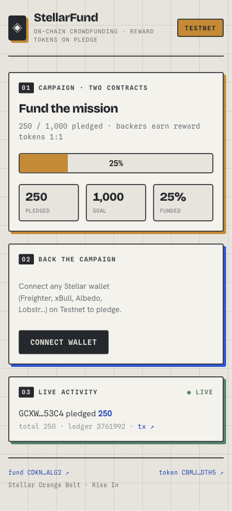
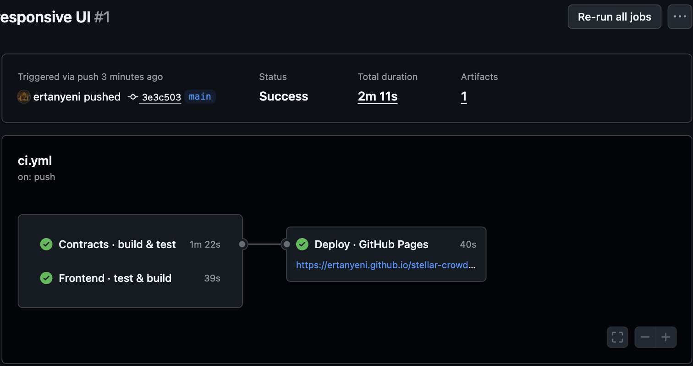
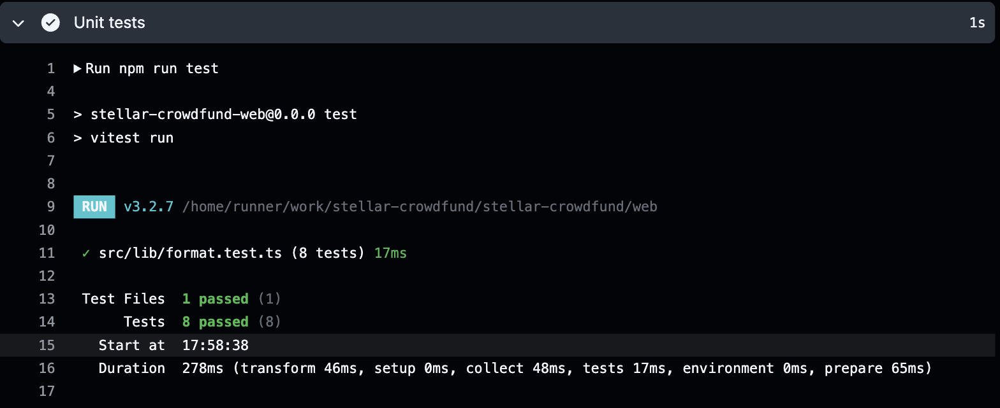

# StellarFund — on-chain crowdfunding on Stellar

A complete, end-to-end crowdfunding dApp on the **Stellar testnet**, built from
**two Soroban smart contracts that talk to each other**. When a backer pledges,
the `Crowdfund` contract records the contribution and makes an **inter-contract
call** to `RewardToken.mint`, rewarding the backer 1:1 in reward tokens.
Progress and a live activity feed are driven by **on-chain contract events**.

Built as the **Orange Belt (Level 3)** submission for the
[Rise In — Stellar Journey to Mastery](https://www.risein.com/programs/stellar-journey-to-mastery-monthly-builder-challenges)
builder challenge.

> **🔗 Live demo:** https://ertanyeni.github.io/stellar-crowdfund/
> **🎬 Demo video:** https://youtube.com/shorts/VqyejItdl1U
> ⚠️ Testnet only — no real funds are involved.

## On-chain references

| | |
| --- | --- |
| **Crowdfund contract** | [`CDKNHK7RJDVGUQ2TBBYW5DQWBRKVP5AF7CCIZIYJWNRF6FSR3URZALG2`](https://stellar.expert/explorer/testnet/contract/CDKNHK7RJDVGUQ2TBBYW5DQWBRKVP5AF7CCIZIYJWNRF6FSR3URZALG2) |
| **RewardToken contract** | [`CBMJ37QJKPTSJIW5EPLGZJWA5XLKE7JFGUCVLNBHGCRQWX6N7HP6DTH5`](https://stellar.expert/explorer/testnet/contract/CBMJ37QJKPTSJIW5EPLGZJWA5XLKE7JFGUCVLNBHGCRQWX6N7HP6DTH5) |
| **Interaction tx** (a `pledge`, which triggers the inter-contract mint) | [`816eb504…e147d803`](https://stellar.expert/explorer/testnet/tx/816eb504e9d6907419015950ae271751e46788f5e27b2fdb300bdd99e147d803) |
| **Network** | Testnet · `Test SDF Network ; September 2015` |

## Screenshots

| Desktop | Mobile responsive |
| --- | --- |
|  |  |

CI/CD pipeline (contracts + frontend tests, then deploy) and frontend test output:

| CI/CD pipeline | Test output |
| --- | --- |
|  |  |

## Architecture — two contracts, one call

```
          pledge(from, amount)                    mint(from, amount)
  backer ───────────────────▶  Crowdfund  ──── env.invoke_contract ────▶  RewardToken
                                  │  records pledge, total, progress          │ credits reward
                                  │  emits ("pledge", from) → (amount,total)   │ tokens 1:1
                                  ▼                                            ▼
                       frontend reads total/goal/progress          frontend reads reward balance
                       + streams pledge events (getEvents)
```

- **`contracts/reward-token`** — a minimal fungible token: `mint` (minter-only), `transfer`, `balance`, `total_supply`, TTL bumps, events.
- **`contracts/crowdfund`** — `pledge` records a contribution and makes an **inter-contract call** (`env.invoke_contract`) to `RewardToken.mint`; exposes `total`/`pledged`/`goal`/`progress_bps` and emits a `pledge` event.
- The crowdfund contract is set as the token's authorised `minter`, so the cross-contract mint is authorised implicitly by the calling contract.

## Requirements mapping (Orange Belt · Level 3)

| Requirement | Where |
| --- | --- |
| Advanced smart contract development | `contracts/` — two contracts, typed errors, TTL management, events |
| **Inter-contract communication** | `Crowdfund::pledge` → `env.invoke_contract` → `RewardToken::mint` |
| Event streaming & real-time updates | `fetchPledgeEvents` (RPC `getEvents`) → live feed + polling loop in `App.tsx` |
| **CI/CD pipeline** | `.github/workflows/ci.yml` — test contracts + frontend, deploy to Pages |
| Smart contract deployment workflow | documented below + the CI deploy job |
| Mobile responsive frontend | responsive layout in `web/src/App.css` (see mobile screenshot) |
| Error handling & loading states | tx status panel, loading placeholders, three wallet error cases |
| Tests for contracts **and** frontend | 10 contract tests (`cargo test`) + 8 frontend tests (`vitest`) |
| Production-ready architecture | typed error enums, TTL bumps, separated lib layers, CI gating |
| Documentation & demo | this README + live demo + demo video |

## Tech stack

- **Contracts:** Rust · [`soroban-sdk`](https://crates.io/crates/soroban-sdk) 26 · `stellar` CLI
- **Frontend:** React 19 · TypeScript · Vite · [`@stellar/stellar-sdk`](https://www.npmjs.com/package/@stellar/stellar-sdk) · [`@creit.tech/stellar-wallets-kit`](https://www.npmjs.com/package/@creit.tech/stellar-wallets-kit)
- **Tests:** `cargo test` (contracts) · [Vitest](https://vitest.dev/) (frontend)
- **CI/CD:** GitHub Actions → GitHub Pages

## Run it locally

### Contracts

```bash
cargo test --workspace          # 10 tests (incl. the inter-contract reward flow)
stellar contract build          # -> target/wasm32v1-none/release/*.wasm
```

### Deployment workflow (testnet)

```bash
stellar keys generate deployer --network testnet --fund
ADMIN=$(stellar keys address deployer)

TOKEN=$(stellar contract deploy --wasm target/wasm32v1-none/release/reward_token.wasm \
  --source deployer --network testnet)
CF=$(stellar contract deploy --wasm target/wasm32v1-none/release/crowdfund.wasm \
  --source deployer --network testnet)

stellar contract invoke --id "$TOKEN" --source deployer --network testnet -- init --admin "$ADMIN"
stellar contract invoke --id "$CF"    --source deployer --network testnet -- \
  init --admin "$ADMIN" --reward_token "$TOKEN" --goal 1000
stellar contract invoke --id "$TOKEN" --source deployer --network testnet -- set_minter --minter "$CF"
```

Then set `CROWDFUND_ID` / `REWARD_TOKEN_ID` in `web/src/lib/constants.ts`.

### Frontend

```bash
cd web
npm install
npm run test      # 8 unit tests
npm run dev       # http://localhost:5173
```

Connect a wallet (Freighter, xBull, Albedo, Lobstr…) on **Testnet**, fund it via
Friendbot, and pledge. Watch the progress, your reward-token balance, and the
live activity feed update from on-chain events.

## CI/CD

Every push and PR runs [`.github/workflows/ci.yml`](.github/workflows/ci.yml):

1. **contracts** — `cargo test --workspace`
2. **frontend** — `npm ci`, `npm run test` (Vitest), `npm run build` (type-check + bundle)
3. **deploy** — on `main`, builds the frontend and publishes it to GitHub Pages

## License

[MIT](LICENSE)
